<div align="center">

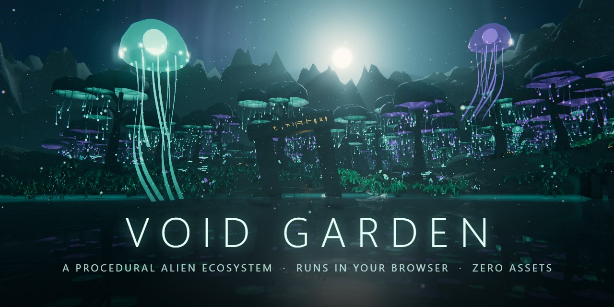

# VOID GARDEN

**A bioluminescent alien world, grown from a single seed, in your browser.**<br>
Terrain, plants, creatures, sky, textures and sound are all generated at load time.<br>
No asset files. No install. No build step.


**[▶ Play it in your browser](https://q4k3z.github.io/void-garden/)** ·
[Gallery](#gallery) · [How it works](#how-it-works) · [Technical report](TECHNICAL_REPORT.md)

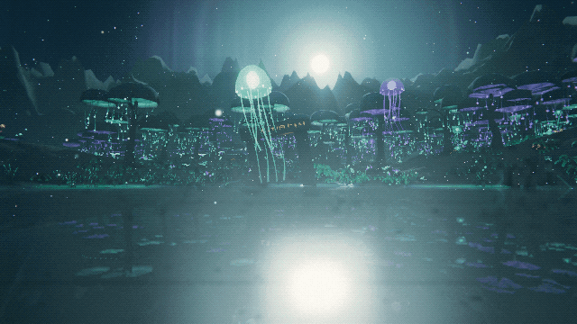

</div>

---

## Highlights

- **100 % procedural.** About 8,500 lines of JavaScript and GLSL generate everything from a seed:
  - an eroded 640 m sector of terrain;
  - PBR rock, moss and sand textures, painted on the GPU at load;
  - a leaf-card foliage atlas;
  - 16 plant forms and 9 animal species;
  - ruins and landmarks;
  - a night sky with a ringed giant;
  - a synthesized soundscape.

  The whole download is source code plus Three.js.
- **Deterministic worlds.** The same seed always builds the same world, verified by
  fingerprinting two full generations. Type any seed on the title screen to get a new one.
- **A living ecosystem.** Most creatures run a behaviour state machine (idle, wander, detect,
  react, return) driven by how much noise you make:
  - herds that graze, keep watch and stampede;
  - skyray flocks that glide on boids steering;
  - glow-eels that school in the lake;
  - a predator that stalks, chases and sometimes misses its prey.
- **Five biomes:** the Lantern Grove, the fungal Violet Wood, the Coral Thicket, the golden
  Amber Heights and the lake shallows. Each has its own flora, ambient chord and journal entry,
  and the grass turns gold or violet with the biome.
- **Procedural animation.** Quadrupeds walk, trot and gallop on a phase-based gait with 2-bone
  leg IK that plants every foot on the terrain. Wings flap and eels swim through vertex-shader
  deformation, so a whole flock is a single draw call.
- **Rendering:**
  - triplanar, height-blended terrain;
  - long-range moon shadows baked over the heightfield;
  - planar lake reflections;
  - SSAO, light shafts, bloom and ACES grading, with eye adaptation;
  - alpha-to-coverage leaf cards with hue-tinted translucency;
  - creature skin with subsurface wrap.
- **Built to run well:**
  - cell-based instancing with LOD and frustum culling;
  - adaptive resolution driven by real GPU timer queries;
  - four quality presets;
  - a shader warm-up that removes mid-game compile stalls.

## Gallery

| | |
| :---: | :---: |
| 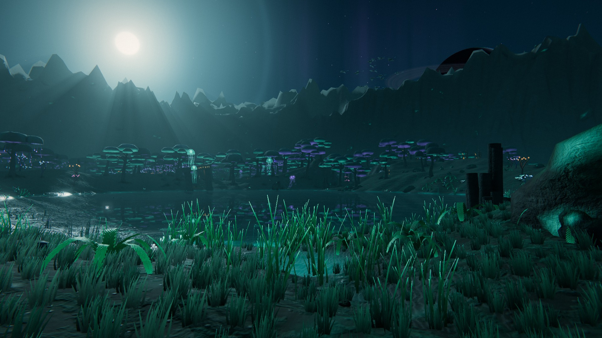 | 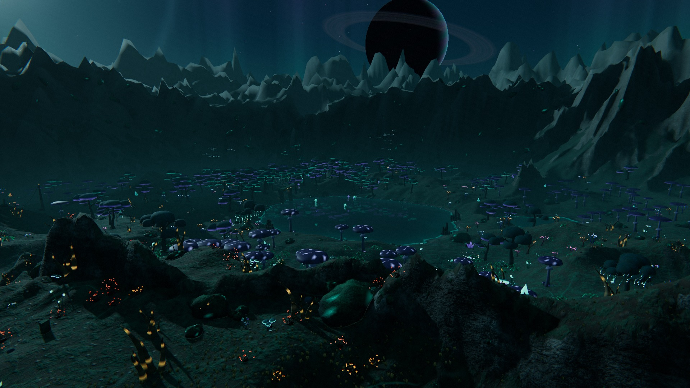 |
| **Landing site.** The moon rises over the lake; the ringed giant waits behind the ridge. | **The basin.** Every ridge, lake and grove comes from the seed. |
| 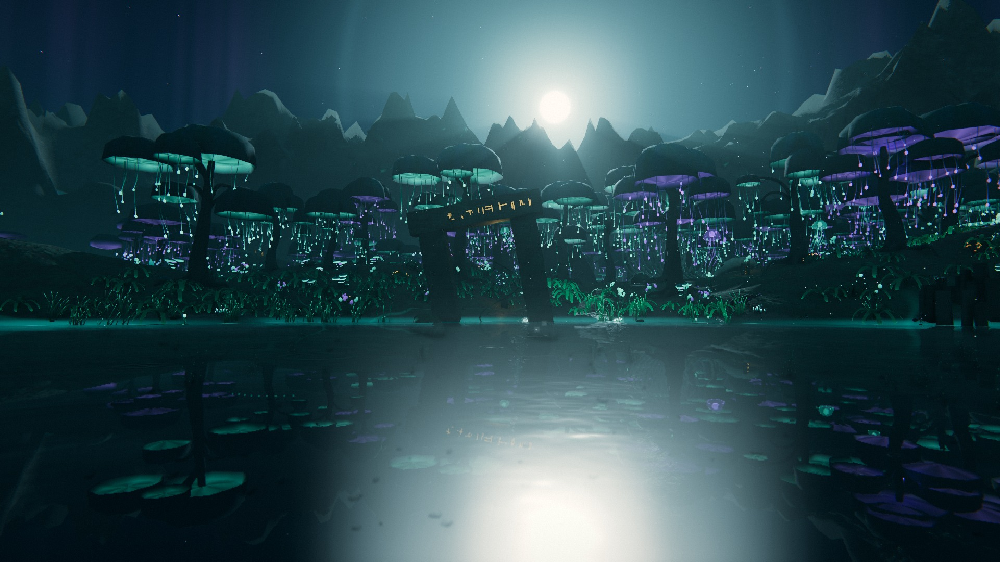 | 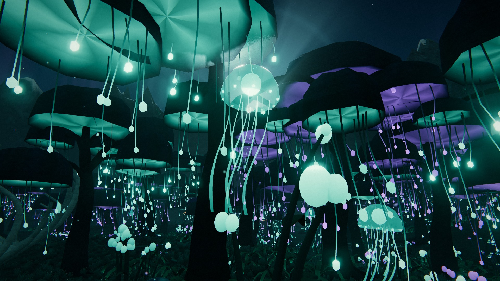 |
| **Sunken Gate.** Planar reflections and lily pads on the lake shallows. | **Lantern Grove.** Gill-lit caps and drifting luminous threads. |
| 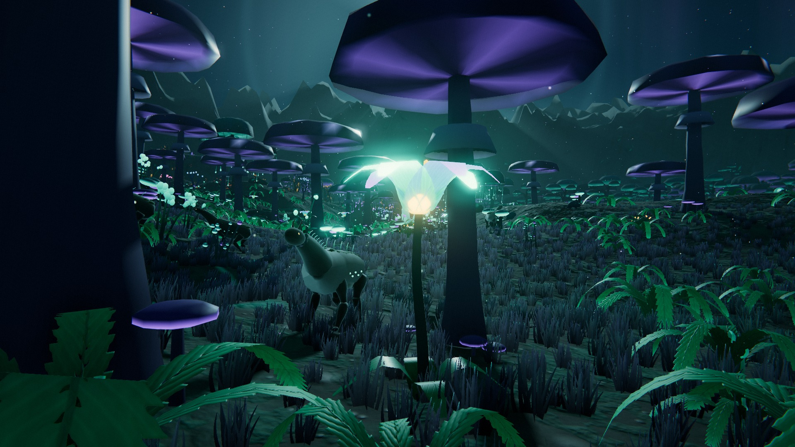 | 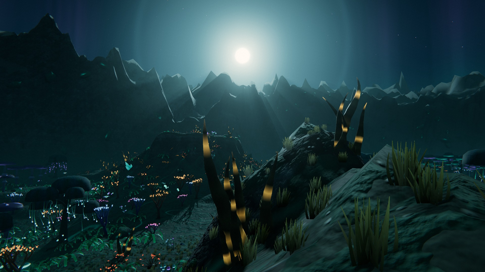 |
| **Violet Wood.** Parasol fungi, a lumen bloom and a grazing mossback. | **Amber Heights.** Spire horns ringed with amber light on dry, golden ground. |
| 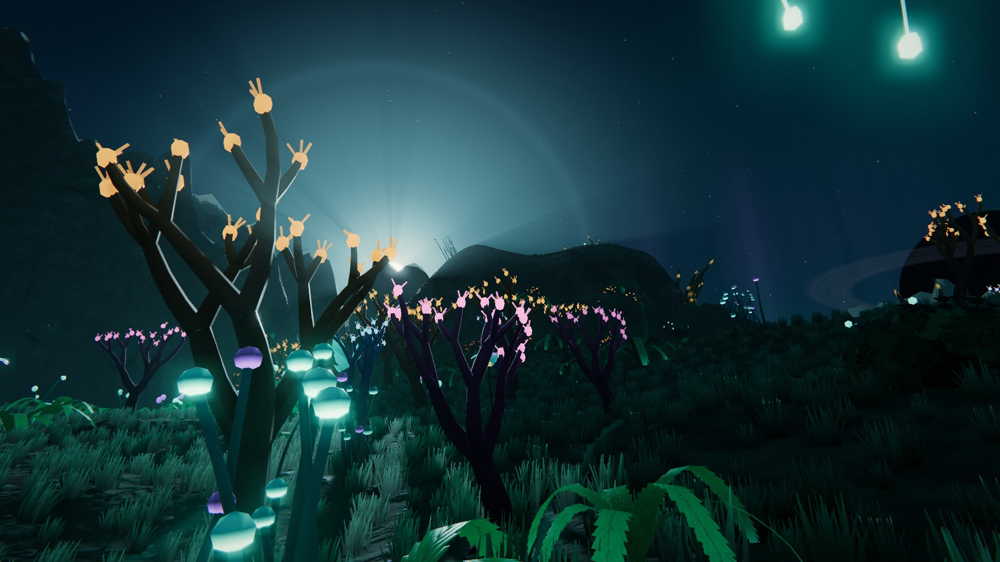 | 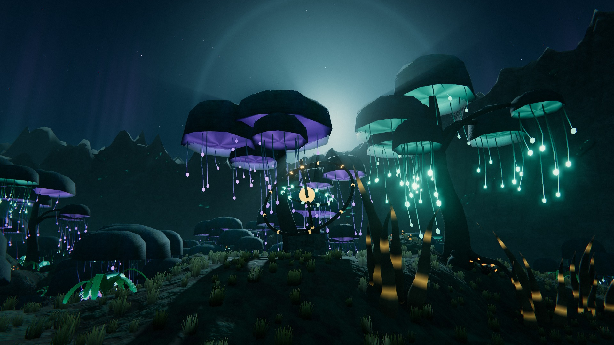 |
| **Coral Thicket.** Branching growths tipped with living polyps. | **The Orrery.** Three rings still turn around a burning core. Align them to bring them to rest. |

All screenshots are rendered by the engine on the Ultra preset at 1920×1080. The camera was
placed with the debug API and the HUD hidden; the images are not edited.

## Play

**Online:** open the [live demo](https://q4k3z.github.io/void-garden/). It needs a desktop
browser with WebGL 2 (current Chrome, Edge, Firefox or Safari).

**Locally:** ES modules must be served over HTTP. Opening `index.html` from disk will not work.

```powershell
python serve.py
```

Then open <http://127.0.0.1:8080/>. Any static server works, for example
`npx http-server -c-1 -p 8080`. The first load fetches Three.js r160 from the jsDelivr CDN;
see [Offline use](#offline-use).

### Controls

| Key | Action |
| --- | --- |
| **W A S D** / arrows | Move |
| **Mouse** | Look (click the view to capture the cursor) |
| **Shift** | Sprint |
| **Space** | Jump / swim up |
| **C** or **Ctrl** | Crouch and sneak (creatures notice you less) / dive while swimming |
| **E** | Interact with the focused object; with nothing focused, send a resonance pulse |
| **J** or **Tab** | Field journal |
| **Esc** | Pause menu (settings, journal, return to the landing site) |
| **R** | Return to the landing site |
| **F3** or **`** | Performance overlay |

If pointer lock is unavailable, the game falls back to click-and-drag mouse look (force it
with `?nolock`). If the cursor is not captured, for example after resuming with **Esc**,
click the view to capture it again. Mouse look uses raw input where the browser supports it,
so use the sensitivity slider if it feels faster or slower than your desktop cursor.

### What there is to do

There are no quest markers. Explore, and record what you find in the field journal (40
entries for the default seed):

* **Places.** Entering a landmark or biome records it: the Listening Ring, the Sunken Gate,
  the Orrery, the Signal Field, the Ossuary Flats, the Hollow, Shard Ridge, the High Table,
  the Violet Wood, the Coral Thicket and the Amber Heights.
* **Flora.**
  * Awaken lumen blooms, and glowmoths migrate to them.
  * Strike resonant crystals, and nearby crystals answer in a chain.
  * Send a resonance pulse through the mycelium.
  * Walk up to the coral trees, parasol fungi, spire horns, thornbrush and lantern lilies.
* **Fauna.** Look at an animal and press **E**, or let it react to you. There are drifters,
  skitterers, veil striders, glowmoths, shy tubes, skyrays, glow-eels, mossbacks and shade
  prowlers. Keep still and quiet near a skitterer herd and you may see a prowler stalk and
  chase.
* **Echoes.** Six standing stones with amber glyphs hold fragments of the planet's history.
* **Landmarks.** Speak at the Listening Altar (aurora), align the Orrery (meteor shower) and
  transmit from the Signal Console.
* **The Glowing Seed** waits at the end of the Hollow. Touching it wakes the whole garden.

Journal progress is saved per seed in the browser.

### URL parameters

| Parameter | Effect |
| --- | --- |
| `?seed=NAME` | World seed (any text, default `LYRA-09`). Same seed, same world. |
| `?quality=low\|medium\|high\|ultra` | Force a quality preset (default: auto-detected). |
| `?autostart` | Skip the title card. |
| `?debug` | Show the performance overlay at start. |
| `?bench=30` | 30 s automated fly-through benchmark; prints the results to the console and on screen. |
| `?nolock` | Drag-to-look instead of pointer lock. |

## How it works

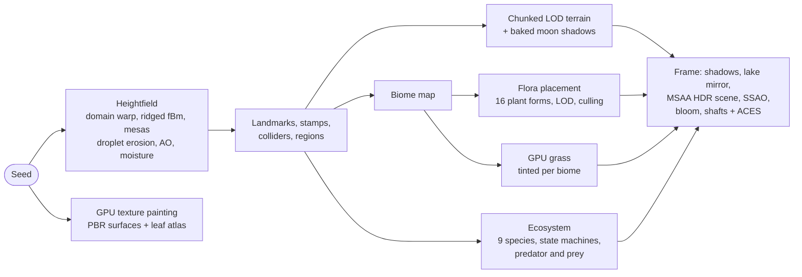

The [technical report](TECHNICAL_REPORT.md) covers each system, the performance work, the
testing evidence and the known limitations.

| Area | Techniques |
| --- | --- |
| World generation | Seeded labelled RNG streams, domain-warped ridged multifractals, droplet hydraulic erosion, AO and moisture maps, site selection with landmark stamps, noise-driven biome map |
| Rendering | Three.js on WebGL 2, injected GLSL (`onBeforeCompile`), triplanar PBR, height fog, planar reflections, SSAO, light shafts, bloom, eye adaptation, alpha-to-coverage foliage, MSAA-safe emissive shading |
| Simulation | Behaviour state machines, herd panic propagation, boids, schooling, predator–prey with satiety and stamina, 2-bone IK, phase-based gaits |
| Audio | Web Audio synthesis only: drones per region, spatial creature calls, footsteps by surface, chimes |
| Engineering | Instancing with cell LOD and culling, GPU-timer adaptive resolution, real-pipeline shader warm-up, allocation-free hot loops, deterministic generation |

## Performance

| Preset | Resolution scale | MSAA | Shadows | SSAO | Lake reflections | Surface textures | Vegetation | GPU grass |
| --- | --- | --- | --- | --- | --- | --- | --- | --- |
| Low | 0.85× | – | off | off | sky approximation | 512² | 45 % | off |
| Medium | 1.0× | 2× | 1024 | 8 samples | sky approximation | 1024² | 70 % | 84² tufts |
| High | 1.0× (≤1.5 dpr) | 4× | 2048 | 12 samples | planar, 0.5× res | 1024² | 100 % | 116² tufts |
| Ultra | 1.25× (≤2 dpr) | 4× | 4096 | 16 samples | planar, 0.6× res | 2048² | 125 % | 144² tufts |

Measured on the development machine (RTX 3070 Ti, Chrome, 120 Hz display; full details in the
[technical report](TECHNICAL_REPORT.md#5-testing-evidence)):

| Test | Result |
| --- | --- |
| `?bench=20` fly-through, High, 1297×723 (before the ecosystem update) | **119.6 FPS average, 99 FPS 1 % low**, capped by the display |
| GPU time per frame, High, 1920×1080 | about 4–8 ms depending on the view and the GPU clock state |
| Creature simulation, all species | 0.17 ms per update |

Adaptive resolution (on by default) measures real GPU time and keeps frames inside a 60 FPS
budget by scaling between 0.6× and 1.0×. Live settings, with no reload: render scale, adaptive
resolution, shadows, bloom, light shafts, field of view, mouse sensitivity, invert Y and
volume.

## Offline use

Download `three.module.js` (r160) and the `examples/jsm` addons used here
(`postprocessing/EffectComposer.js`, `RenderPass.js`, `UnrealBloomPass.js`, `ShaderPass.js`,
`MaskPass.js`, `Pass.js`, `objects/Reflector.js`, `utils/BufferGeometryUtils.js`,
`shaders/CopyShader.js`, `shaders/LuminosityHighPassShader.js`) into a local folder, and point
the import map in `index.html` at it.

## Deploy your own copy

The repository includes a GitHub Pages workflow (`.github/workflows/pages.yml`). After pushing
to `main`, open **Settings → Pages**, set **Source** to **GitHub Actions**, and the game is
published at `https://<user>.github.io/<repo>/`.

## Project layout

```
index.html                 entry point (HUD, menus, import map)
serve.py                   local no-cache server
src/main.js                bootstrap, main loop, input, menus, adaptive resolution, benchmark, debug API
src/config.js              world constants, quality presets, settings, URL params
src/game.js                interaction, resonance pulse, discovery and journal, finale
src/content.js             journal and echo text
src/core/                  seeded RNG, simplex/value noise + fBm/ridged, shared uniforms, yield helper
src/world/heightfield.js   macro layout, analytic terrain, hydraulic erosion, AO, moisture, queries
src/world/terrain.js       chunked LOD terrain + skirts, far backdrop ring, terrain material
src/world/sky.js           sky dome, height-fog shader chunks, PMREM environment
src/world/water.js         water table, planar reflection, shoreline sampling
src/world/geo.js           GeoBuilder (procedural tubes, ellipsoids, ribbons, prisms)
src/world/materials.js     "bio" material: wind, player push, bioluminescence, skin, wing flap, swimming
src/world/scatter.js       cell-based instanced rendering with LOD and frustum culling
src/world/plants.js        lantern trees, stalks, blooms, mushrooms, ferns, bushes, reeds
src/world/plants2.js       biome flora: coral trees, parasol fungi, spire horns, thornbrush, lily pads, kelp
src/world/vegetation.js    biome map and ecological placement of flora
src/world/grass.js         GPU grass that follows the camera
src/world/rocks.js         boulders, cliff slabs, pebbles, basalt, crystals, arches
src/world/ruins.js         ring, gate, orrery, pylons, leviathan bones, echo stones, the Hollow
src/world/atmosphere.js    spores and glimmers, atmospheric event director, wind
src/world/world.js         site selection, stamps, colliders, regions, generation pipeline
src/life/creatures.js      drifters, skitterers, veil striders, glowmoths, shy tubes, the Life manager
src/life/fauna2.js         skyray flocks, glow-eels, quadruped rig: mossback herds and shade prowlers
src/player/player.js       first-person controller
src/render/lights.js       moon + shadows, hemisphere fill, bio-light pool
src/render/post.js         SSAO + bloom + final composite pass
src/render/texgen.js       GPU-generated PBR surface textures (rock, moss/soil, sand)
src/render/foliagegen.js   GPU-generated leaf-card atlas
src/shaders/*.glsl.js      GLSL for terrain, water, sky, post, shared noise
src/audio/audio.js         synthesized spatial soundscape
src/ui/hud.js, style.css   HUD, journal UI, styles
docs/media/                screenshots, demo GIF, social preview image
```

With the game running, the browser console exposes a debug API at `window.VG`:
`VG.stats()`, `VG.gpuSamples()`, `VG.sites()`, `VG.teleport(x, z, yaw)`,
`VG.freeCam(x, y, z, yaw, pitch)` / `VG.freeCam(null)`, plus the live `world`, `life`,
`player` and `game` objects.

## Roadmap

- [ ] Optional build step: bundled, minified, offline-ready release
- [ ] Cache generated worlds per seed (IndexedDB) for near-instant reloads
- [ ] Fewer draw calls with `BatchedMesh` / multi-draw
- [ ] Generation in a Web Worker
- [ ] More species and behaviours (nesting, migration, night/day activity)

Ideas, issues and pull requests are welcome.

## Credits

Built with [three.js](https://threejs.org/) (MIT). Everything else, including the textures,
geometry, animation, sky and audio, is generated by the code in this repository.

## License

[MIT](LICENSE)
